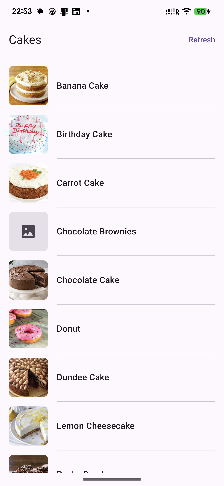
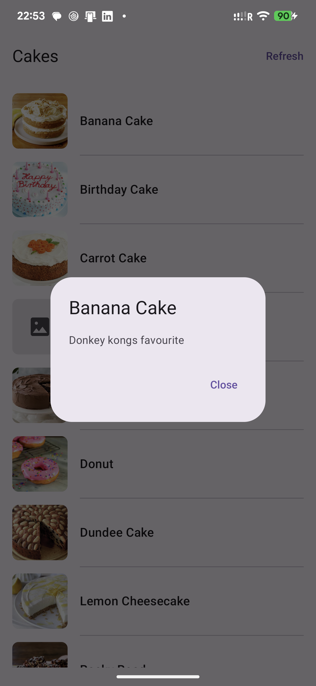
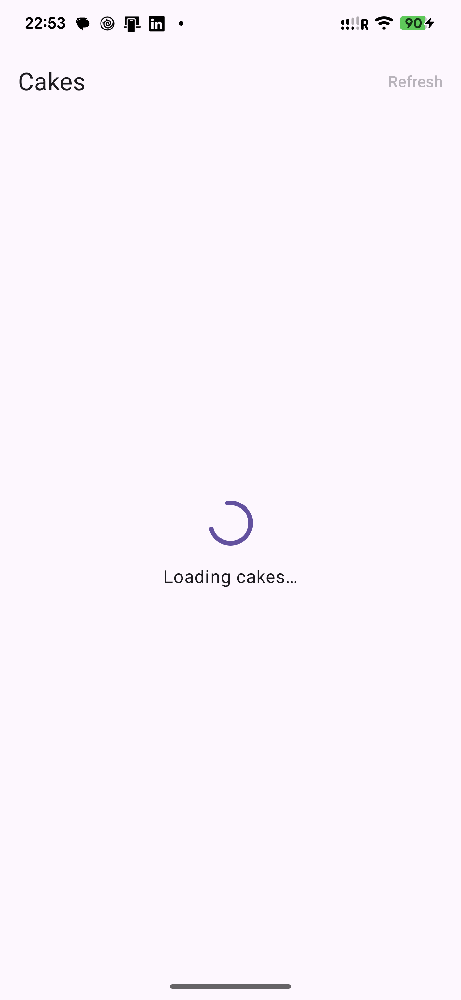
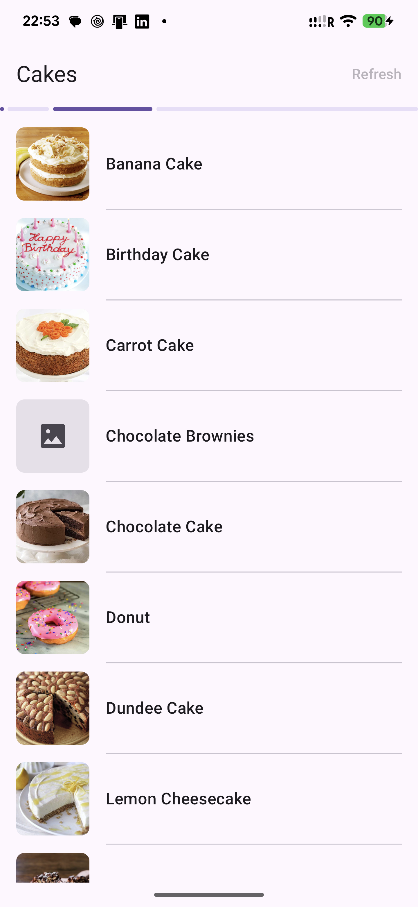
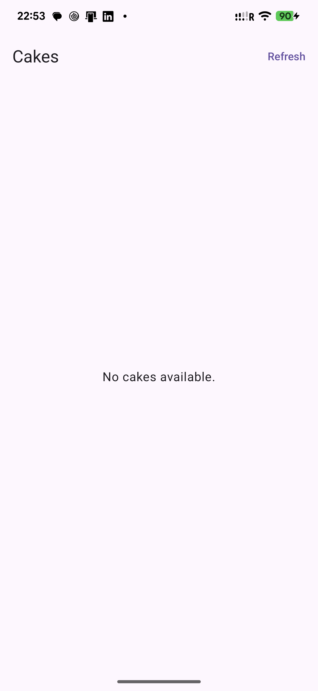
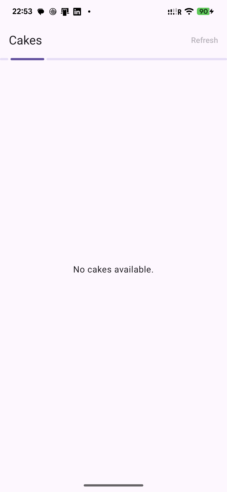
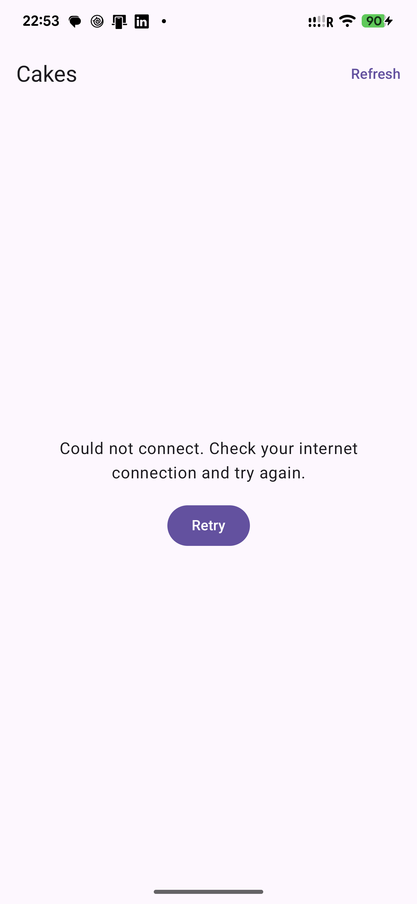
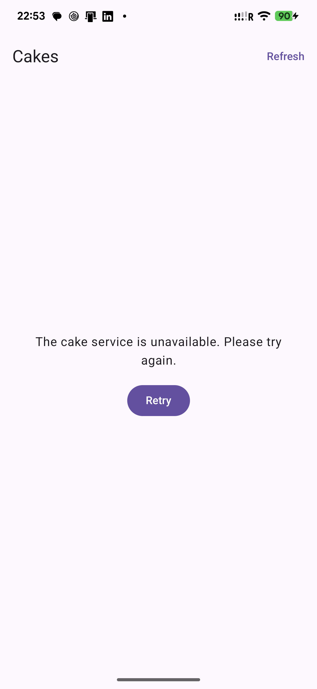
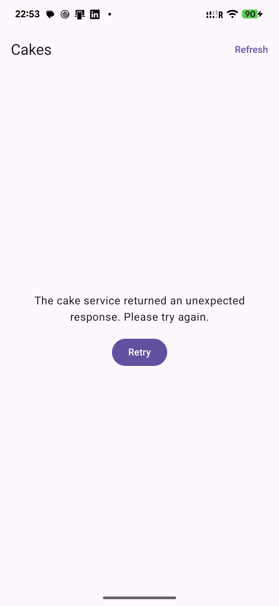
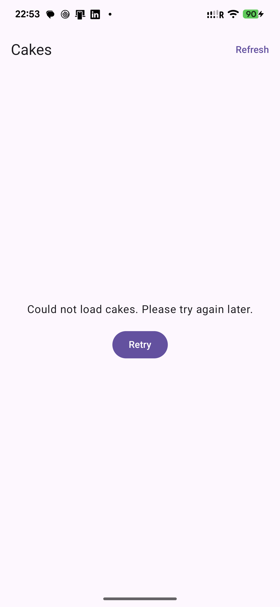

# CakeListApp

A small Android example for the Waracle mobile coding exercise, built with Kotlin, Jetpack Compose and Material 3.

## Features

- Loads cakes from the [provided API endpoint](https://raw.githubusercontent.com/Waracle/mobile-coding-test-api/refs/heads/main/cakes).
- Removes exact duplicates and sorts titles alphabetically, ignoring case.
- Displays cake images, titles and dividers, with image placeholders while loading or on failure.
- Opens the description in a dismissible dialog when a row is tapped.
- Supports refresh, loading and empty states, and error messages with Retry.
- Keeps existing content visible during refresh; a failed refresh switches to the error screen.
- Fades and slides the list into view on initial load and successful refresh.
- Retains loaded data across orientation changes through an activity-scoped ViewModel.

## Setup and run

### Requirements

- Android Studio compatible with Android Gradle Plugin **9.4.1**. The project was developed with Android Studio **2026.1.4**.
- **JDK 21** to run Gradle. App source compatibility is Java 17.
- Android SDK **37** for compilation. The minimum supported device version is **Android 7.0 / API 24**.
- Internet access for the first Gradle sync and for loading cakes and remote images.

The repository includes the **Gradle 9.6.0 wrapper**; a separate Gradle installation is unnecessary. Dependency versions are defined in [`gradle/libs.versions.toml`](gradle/libs.versions.toml).

1. Clone the repository:

   ```bash
   git clone https://github.com/VitaliiKhorobchuk/CakeListApp.git
   cd CakeListApp
   ```

2. Open the project root in Android Studio and install SDK 37 through SDK Manager if needed.
3. In **Settings > Build, Execution, Deployment > Build Tools > Gradle**, select JDK 21 as the Gradle JDK, then sync the project. Android Studio writes the local SDK path to `local.properties`; this machine-specific file is ignored by Git.
4. Select an emulator or a physical device with USB debugging enabled and run the **app** configuration. No API key or account is required.

To build from a terminal on Windows PowerShell:

```powershell
# JAVA_HOME must point to your JDK 21 installation.
.\gradlew.bat assembleDebug
```

On macOS/Linux, use `./gradlew assembleDebug`. If necessary, make the wrapper executable with `chmod +x gradlew`.

The debug APK is written to `app/build/outputs/apk/debug/app-debug.apk`. To install it on a connected device, use `adb install -r app/build/outputs/apk/debug/app-debug.apk` or run `installDebug` through the Gradle wrapper. When using the terminal, ensure `JAVA_HOME` and the Android SDK location are configured independently of Android Studio's Gradle JDK setting.

## Architecture

The app uses MVVM with a lightweight Clean Architecture structure inside one Gradle module. Keeping the layers as packages avoids unnecessary module and DI-framework setup for this small example.

```text
app/src/main/java/com/example/cakelistapp/
├── data/
│   ├── remote/           Retrofit API, response DTO and domain mapping
│   └── RemoteCakeRepository.kt
├── domain/
│   ├── model/            Cake and loading-error types
│   ├── repository/       CakeRepository contract
│   └── usecase/          GetCakesUseCase: duplicate removal and sorting
├── ui/cakes/             Compose UI, ViewModel and UI state
├── di/                   Small application-scoped dependency container
├── CakeListApplication.kt
└── MainActivity.kt
```

- **Domain:** contains the model, repository interface and business rules, with no Android or networking dependencies. Duplicate detection compares all three fields (`title`, `description`, `imageUrl`) exactly; entries sharing only a title remain distinct. Sorting is case-insensitive and stable.
- **Data:** Retrofit and OkHttp load JSON, Gson maps `title`, `desc` and `image` into DTOs, and the repository converts them to domain models. Network, HTTP and invalid-data failures become domain error categories. Coroutine cancellation is propagated.
- **Presentation:** `CakeListViewModel` exposes a `StateFlow<CakeListUiState>` containing `Loading`, `Content` or `Error`. It starts the initial request, handles refresh/retry and prevents overlapping requests. Compose collects state with lifecycle awareness. Dialog selection is local saveable UI state, rather than business state in the ViewModel.
- **Wiring:** `AppContainer` creates the network client, repository and use case. `MainActivity` creates its ViewModel through the lifecycle-aware `viewModel` initializer. Hilt/Koin is left as a future option if the dependency graph grows.

Coil handles asynchronous image loading and caching. Manual refresh is explicit; there is no automatic retry loop. The current light Material 3 styling intentionally keeps the UI small and straightforward.

## Unit tests and checks

Run the local JVM tests without a device or a running API:

```powershell
.\gradlew.bat testDebugUnitTest
```

On macOS/Linux, use `./gradlew testDebugUnitTest`. Tests can also be run from the gutter icons in Android Studio.

The suite contains **18 tests**:

- **7 use-case tests:** exact duplicate removal, retaining distinct records, case-insensitive sorting, stable ordering, empty results, failure propagation and cancellation.
- **11 ViewModel tests:** initial loading/success/failure, empty content, refresh and retry, refresh failure entering `Error`, overlapping-request prevention and cancellation when cleared.

JUnit 4 / Kotlin test assertions and `kotlinx-coroutines-test` are used with small fake repositories. A test Main dispatcher controls coroutine execution without sleeps or live network requests. Repository/API contract tests and Compose UI tests are outside the current scope.

The HTML test report is generated at `app/build/reports/tests/testDebugUnitTest/index.html`.

Run the full local checks:

```powershell
.\gradlew.bat testDebugUnitTest lintDebug assembleDebug
```

The lint report is generated at `app/build/reports/lint-results-debug.html`. Dependency-update warnings are currently present; toolchain/library upgrades should be checked together rather than applied blindly.

## Screenshots

The list and dialog use live API data. Loading, refreshing, empty and error examples render the actual Compose screen with fixed UI states through a temporary debug-only capture activity, which was removed afterwards. These illustrate appearance, rather than claiming end-to-end verification of every failure path. The static images do not show the entry animation.

| Loaded list, including an image fallback | Description dialog |
| --- | --- |
|  |  |

| Initial loading | Refreshing existing content |
| --- | --- |
|  |  |

| Empty result | Refreshing an empty result |
| --- | --- |
|  |  |

| Network error | Server error |
| --- | --- |
|  |  |

| Invalid response | Unexpected error |
| --- | --- |
|  |  |

## Known limitations and future work

- **Online data only:** cake data has no persistent cache. Process recreation fetches again, and loss of connectivity can show an error. A local cache needs an explicit freshness policy if offline use is required.
- **External dependencies:** the endpoint and third-party image URLs must remain available. Some image hosts reject requests; the placeholder remains visible instead of failing the list.
- **Small-feed assumptions:** the endpoint has no stable IDs or pagination. List identity is positional; sorting and duplicate removal run on the caller's dispatcher. Larger feeds would benefit from stable IDs and background processing. If the backend introduces page/cursor support, consider Paging 3 with append/retry states and consistent sorting and duplicate handling across pages.
- **Saved state:** the selected cake's fields are saved to restore the dialog. Long descriptions could make the saved-state Bundle too large; an ID plus a local cache would be safer at scale.
- **Presentation:** the app currently uses a light theme. Dark mode, short-screen/large-font status layouts, and automated accessibility/UI checks remain future work. Title text is limited to two lines; the dialog shows the full title and description.
- **Response handling and diagnostics:** invalid required fields fail the whole response. Gson parsing exceptions could be translated more narrowly inside a converter. Unexpected exceptions currently produce a generic error without a diagnostic logger.
- **Coverage:** unit tests focus on business rules and ViewModel behavior. API contract and instrumented UI tests are not included. Device checks for rotation, large fonts, disabled animations and error recovery should be completed separately.

Focused `TODO` comments beside the relevant implementation describe these tradeoffs and possible DI improvements.

## AI assistance

AI assistance included unit-test suggestion, edge-case review and documentation generation.
